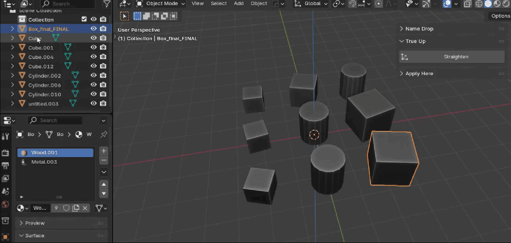
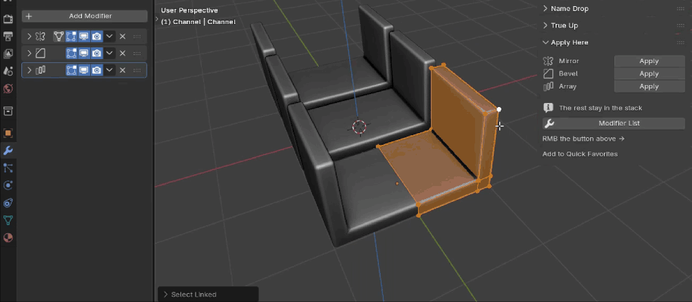
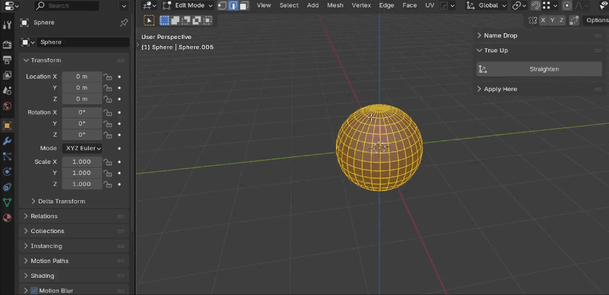
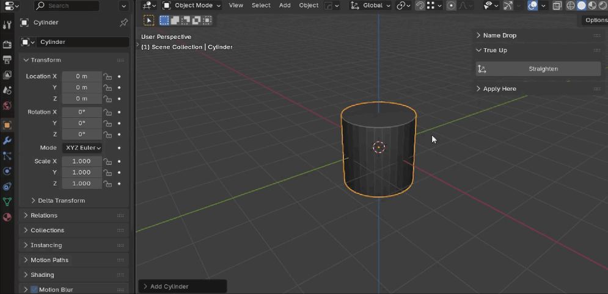
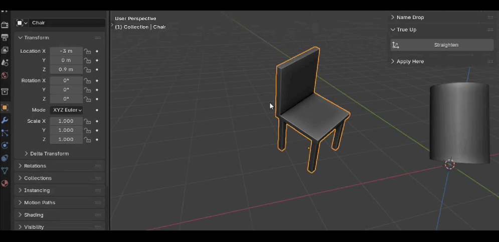
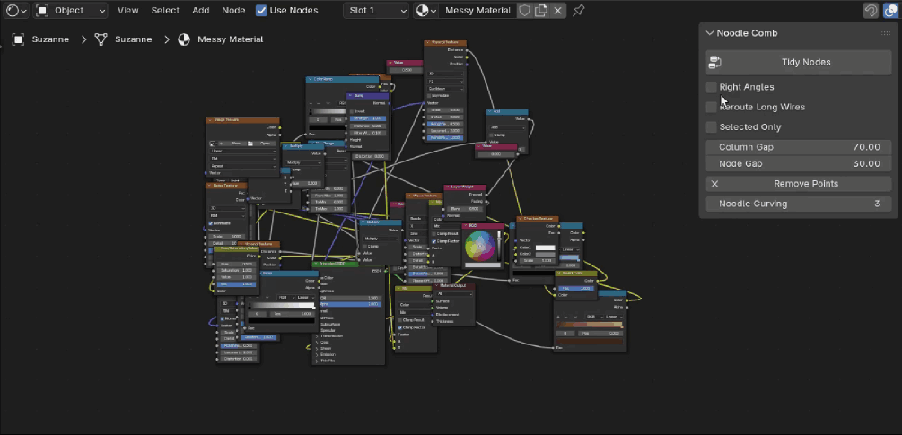

# Nano Tools

Small everyday add-ons for Blender by **m3shtry**: one job each, no clutter. Free, open source, Blender 4.2 or newer.

All of them live in one Sidebar tab, **Nano Tools**: press **N** in the 3D View. Noodle Comb is in the same tab in the Node Editor.

| Add-on | What it does |
|---|---|
| [Name Drop](name_drop/README.md) | Batch rename objects with their meshes and materials |
| [Apply Here](apply_here/README.md) | Apply one modifier without leaving Edit Mode |
| [True Up](true_up/README.md) | Stand a tilted prop straight by its own faces |
| [Noodle Comb](noodle_comb/README.md) | Untangle any node tree with one click |

## Install

1. Download the zip of the add-on you want from [Releases](../../releases). Don't unzip it.
2. In Blender: **Edit > Preferences > Get Extensions**, arrow menu at the top right **> Install from Disk**, pick the zip.
   Or drag the zip into the Blender window.
3. To remove an add-on: **Get Extensions**, find it, its arrow menu **> Uninstall**.

## Name Drop

Select objects, press **F2**, type a name: `Crate_1`, `Crate_2`, `Crate_3`, meshes too, each with its own materials.
[More](name_drop/README.md)

## Apply Here

Apply one modifier from the list and stay in Edit Mode, the rest of the stack stays as it is.
[More](apply_here/README.md)

## True Up

One button. In Object Mode it stands a prop straight by its own faces. In Edit Mode it straightens by what you pick:
a face, an edge loop, a straight edge, a few verts, a cylinder cap and a side edge.
[More](true_up/README.md)

## Noodle Comb

Columns from the output leftwards, every wire left to right, no overlapping nodes. Right Angles for flat wires.
[More](noodle_comb/README.md)

## License

GNU GPL v3 or later, like Blender itself: see [LICENSE.txt](LICENSE.txt).

Each add-on has a `NOTICE.txt` with three additional terms under section 7 of the GPL:
keep the credit **m3shtry**; if you change an add-on and pass it on, give it another name and say it is based on the original;
the name **m3shtry** is not for branding other products.

Author: **m3shtry**.
